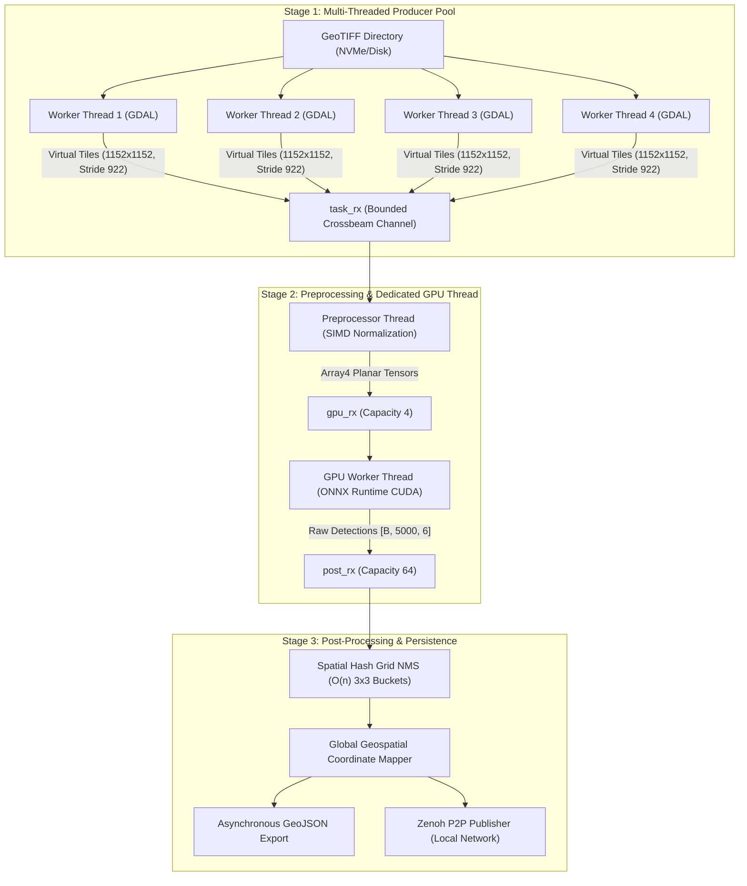

# SAMDEF Detector: Zero-Wait Edge Streaming Inference Engine

High-performance, air-gapped geospatial object detection engine written in native Rust. Designed for real-time edge processing of massive multi-gigabyte GeoTIFF satellite and aerial imagery without cloud dependency.

---

## 1. Benchmark: SAMDEF vs. SAHI Baseline

Performance comparison of SAMDEF's end-to-end streaming pipeline against **SAHI** (*Slicing Aided Hyper Inference*).


Both systems were benchmarked on the **identical 281 multi-band GeoTIFF images** using the **identical ONNX model weights (`run15_FP16.onnx`)** executed on an **NVIDIA GeForce RTX 4060 Laptop GPU (8GB GDDR6)** via ONNX Runtime CUDA.

### Head-to-Head Performance Matrix

| Metric | SAHI Baseline (Python + CUDA) | SAMDEF (Rust Engine) | Advantage / Speedup |
| :--- | :--- | :--- | :--- |
| **Model & Weights** | `run15_FP16.onnx` (FP16 Tensor Cores) | `run15_FP16.onnx` (FP16 Tensor Cores) | **Identical weights** |
| **Execution Provider** | ONNX Runtime `CUDAExecutionProvider` | ONNX Runtime `CUDAExecutionProvider` | **Identical hardware & CUDA runtime** |
| **Tile Resolution** | $1152 \times 1152$ | $1152 \times 1152$ | **Identical tile size** |
| **Tile Overlap** | 20% overlap (`stride = 922`) | 20% overlap (`stride = 922`) | **Exact same spatial stride** |
| **Classes** | 15 Classes | 15 Classes | **Identical class mapping** |
| **Confidence Cutoff**| `0.01` | `0.01` | **Identical detection threshold** |
| **Dataset Evaluated** | 281 GeoTIFF images | 281 GeoTIFF images | **Identical validation images** |
| **Total Wall-Clock Time** | **99.07 s** | **49.83 s** | **SAMDEF is 2.0× FASTER** |


### Why SAMDEF is 2.0× Faster than SAHI

```text
SAHI (Sequential Stop-and-Wait):
[Read GeoTIFF] -> [Slice in Python] -> [GPU Inference] -> [Python Pairwise NMS] -> [Next Image]
     CPU                 CPU                 GPU                 CPU
* Problem: When CPU reads or runs NMS, the GPU sits idle (0% utilization).
* Memory : Allocates & tears down >700,000 Python heap objects across 281 images.

SAMDEF (Concurrent 3-Stage Pipeline):
[4 GDAL Producer Threads] ===> Lock-Free Queue ===> [Dedicated GPU Thread] ===> [Spatial Grid NMS & IO]
   (Pre-fetching Tiles)                             (100% Saturation)               (Concurrent)
* Advantage: Zero GPU idle bubbles. GPU is continuously fed pre-normalized buffers.
* Memory   : Contiguous stack/vector memory directly in Rust; zero heap churn.
* NMS      : Localized 3x3 spatial hash grid achieves O(n) suppression.
```


---

## 2. Core Architecture: Decoupled 3-Stage Pipeline

SAMDEF's detector eliminates GPU starvation through an asynchronous, decoupled multi-threaded architecture connected via bounded, lock-free **Crossbeam channels**.



### Pipeline Stages Explained

1. **Stage 1 — Multi-Threaded Producer Pool (`producer.rs`, `virtual_tiler.rs`)**:
   - Spawns $N$ OS worker threads (default: 4) using native C-bindings to GDAL.
   - Computes virtual bounding windows ($1152 \times 1152$ with $922$ stride, ~20% overlap).
   - Reads raw multi-band raster data directly from disk ahead of time.
   - Pushes raw tile payloads into a bounded Crossbeam channel (`msg_tx`).

2. **Stage 2 — Preprocessing & Dedicated GPU Thread (`pre_processing.rs`, `inference.rs`)**:
   - **Pre-processor Worker**: Pulls raw byte buffers from `task_rx`, performs SIMD planar conversion ($HWC \to CHW$) and FP32 $[0.0, 1.0]$ normalization.
   - **Zero Float16 CPU Bottleneck**: Feeds FP32 host arrays directly into ONNX Runtime's CUDA memory manager. The GPU's native Tensor Cores handle FP16 computation internally, avoiding slow CPU-side half-precision float conversions.
   - **Dedicated GPU Worker**: Runs an uninterrupted CUDA execution loop over `gpu_rx`. Because tiles are pre-buffered, GPU idle bubbles are completely eliminated.

3. **Stage 3 — Spatial Grid NMS & Asynchronous Export (`post_processing.rs`, `consumer.rs`)**:
   - Converts local tile bounding boxes back to full-image and global geospatial coordinates (WGS-84).
   - **Spatial Hash Grid NMS**: Instead of standard quadratic pairwise comparison ($\mathcal{O}(n^2)$), detections are indexed into localized $3 \times 3$ spatial bins, running Non-Maximum Suppression in linear time ($\mathcal{O}(n)$).
   - Spawns background async Tokio tasks to write structured detection JSONs to disk and publish telemetry via Zenoh without stalling the inference pipeline.

---

## 3. Model Specifications

- **Architecture:** YOLO26s with fused post-NMS head (`[1, 5000, 6]`).
- **Checkpoint:** `run15_FP16.onnx`.
- **Input Dimensions:** Dynamic batch, $3 \times 1152 \times 1152$ (FP32).
- **Output Tensor:** Shape `[batch, 5000, 6]` formatted as `[x1, y1, x2, y2, confidence, class_id]`.
- **Precision:** FP16 Tensor Cores with FP32 host IO.
- **15 Classes:**
  `0: Light-Vehicle`, `1: Boxy-Truck`, `2: Long-Trucks`, `3: Small-Boat`, `4: Large-Ship`, `5: Fixed-Wing`, `6: Helicopter`, `7: Building`, `8: Other-Structure`, `9: Storage-Tank`, `10: Container-Lot`, `11: Construction-Site`, `12: Railway`, `13: Engineering-Machinery`, `14: Tower-Pylon`.


---

## 4. Configuration & Environment Variables

The detector is configured declaratively via `.env` in the crate root:

```env
# Input directory containing multi-band GeoTIFF images
INPUT_DIR=/home/shatadal/SAMDEF_DATA/val_images


# Output directory for structured detection JSON results
OUTPUT_DIR=/home/shatadal/SAMDEF_DATA/raw_data/inference/results

# Path to the exported FP16 ONNX model
MODEL_PATH=/home/shatadal/PROJECTS/SAMDEF/apps_deploy/detector/model/run15_FP16.onnx

# Inference batch size (Batch 1 yields peak throughput and lowest latency)
BATCH_SIZE=1

# Number of parallel producer threads reading GeoTIFFs via GDAL
PRODUCER_PARALLELISM=4
```

---

## 5. Building & Running

### Prerequisites
- Rust 1.75+ (Cargo)
- NVIDIA CUDA Toolkit & cuDNN compatible with ONNX Runtime
- GDAL C-libraries (`libgdal-dev`)

### Compile Release Binary
```bash
cargo build --release -p samdef_detector
```

### Run Pipeline
```bash
# Using cargo
cargo run --release -p samdef_detector

# Or executing the compiled binary directly
./target/release/samdef_detector
```

### Run Unit Tests
```bash
cargo test -p samdef_detector
```

