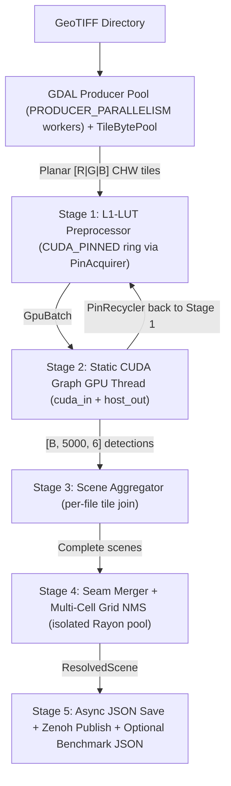

# SAMDEF Detector (`samdef_detector`)

Rust geospatial inference engine for large multi-band GeoTIFF imagery using ONNX Runtime (`CUDAExecutionProvider`).

## 1. Benchmark: SAMDEF vs. SAHI Baseline

Evaluated on the **same 281 GeoTIFF images** with **identical ONNX weights (`run15_FP16.onnx`)**, slice geometry (`1152x1152`, 20% overlap / stride `922`), batch size (`1`), confidence threshold (`0.01`), and GPU (**NVIDIA GeForce RTX 4060 Laptop GPU**):

| Metric | SAHI Baseline (Python + CUDA) | SAMDEF (Rust + CUDA) | Notes |
| :--- | :--- | :--- | :--- |
| **Model & Weights** | `run15_FP16.onnx` | `run15_FP16.onnx` | Identical weights |
| **Batch Size / Threshold** | `1` / `0.01` | `1` / `0.01` | Matched config |
| **Images Evaluated** | 281 | 281 | Identical dataset |
| **Total Detections** | 575,876 | 520,192 | Threshold parity |
| **Total Wall-Clock Time** | **93.15 s** | **46.54 s** | **SAMDEF 2.0x faster** |
| **Throughput** | 3.017 img/s (181.0 /min) | 6.037 img/s (362.24 /min) | 2.0x speedup |
| **GPU Utilization (Mean / Max)** | 41.6% / 59.0% | **95.4% / 99.0%** | Continuous GPU feed |
| **Peak VRAM Used** | 1,229 MiB | **519 MiB** | Lower device memory |

Batch sweep recorded in [`logs/runs_history.csv`](logs/runs_history.csv) (`281` images, `PRODUCER_PARALLELISM=4`):
- `BATCH_SIZE=1`: **46.54 s** (`6.037 img/s`, `95.4%` mean GPU, `519 MiB` VRAM)
- `BATCH_SIZE=2`: **49.11 s** (`5.722 img/s`, `94.6%` mean GPU, `790 MiB` VRAM)
- `BATCH_SIZE=4`: **50.52 s** (`5.562 img/s`, `95.8%` mean GPU, `1,349 MiB` VRAM)

## 2. Core Architecture: Producer Pool + 5-Stage Decoupled Consumer

Bounded Crossbeam channels (`GPU_QUEUE_CAP = 6`, `post_tx = 128`, `nms_tx = 64`) isolate disk I/O, CPU LUT preprocessing, GPU execution, boundary NMS, and async persistence so the GPU stays saturated without idle stalls.



### Key Pipeline Design Choices
- **`TileBytePool` (`buffer_pool.rs`)**: Reuses 3.98 MB planar `[R | G | B]` tile buffers between GDAL producers and Stage 1 to avoid per-tile heap page faults.
- **Page-Locked Ring (`PinAcquirer` / `PinRecycler`)**: Pre-allocates `CUDA_PINNED` host tensors (`GPU_QUEUE_CAP + 2`) recycled straight from Stage 2 back to Stage 1.
- **Static CUDA Graph Binding (`inference.rs`)**: Stage 2 maintains one static device input tensor (`cuda_in`) bound to `IoBinding`, syncing from the rotating pinned host slot via `sync_pinned_to_cuda_in` so CUDA Graph replay addresses remain invariant.
- **Isolated Rayon Pools**: Stage 1 preprocessing (`create_preproc_pool`) and Stage 4 NMS (`post_processing.rs`) run on separate bounded Rayon pools so NMS bursts never starve GPU batch preparation.
- **Boundary-Aware NMS (`geometry.rs`, `seam_merger.rs`, `boundary_nms.rs`)**: Merges detections sliced across overlapping tile seams and performs multi-cell spatial grid NMS in $\mathcal{O}(n)$ time.

## 3. Model Specifications

- **Model:** `run15_FP16.onnx` (YOLO26s with fused post-NMS head)
- **Input:** `[batch, 3, 1152, 1152]` planar FP32
- **Output:** `[batch, 5000, 6]` formatted as `[x1, y1, x2, y2, confidence, class_id]`
- **15 Classes:** `0: Light-Vehicle`, `1: Boxy-Truck`, `2: Long-Trucks`, `3: Small-Boat`, `4: Large-Ship`, `5: Fixed-Wing`, `6: Helicopter`, `7: Building`, `8: Other-Structure`, `9: Storage-Tank`, `10: Container-Lot`, `11: Construction-Site`, `12: Railway`, `13: Engineering-Machinery`, `14: Tower-Pylon`.

## 4. Configuration (`.env`)

See `.env.example` for template keys:
- `INPUT_DIR`: Directory containing input GeoTIFFs.
- `OUTPUT_DIR`: Destination directory for `*_results.json`.
- `MODEL_PATH`: Path to ONNX model (`apps_deploy/detector/model/run15_FP16.onnx`).
- `BATCH_SIZE`: Inference batch size (default `1`).
- `PRODUCER_PARALLELISM`: GDAL worker thread count (default `4`).
- `BENCHMARK_SUMMARY_PATH`: Optional JSON path to emit machine-measured `SamdefBenchmarkSummary` telemetry.

## 5. Building, Running & Testing

```bash
# Run with multi-run telemetry logging (recommended)
cd apps_deploy/detector
./run_detector.sh                                   # Uses .env defaults + writes to logs/
./run_detector.sh --batch 2 --parallel 4 --tag b2   # Overrides batch/threads
./run_detector.sh --no-build                        # Reuse existing release binary

# Or build/test/run directly from workspace root
cargo build --release -p samdef_detector
cargo test -p samdef_detector
cargo run --release -p samdef_detector
```

Each `./run_detector.sh` run writes:
- `logs/<run_id>.log` — raw console output (gitignored)
- `logs/<run_id>_summary.json` — structured runtime + `nvidia-smi` GPU telemetry
- `logs/runs_history.csv` — cumulative comparison table across runs
